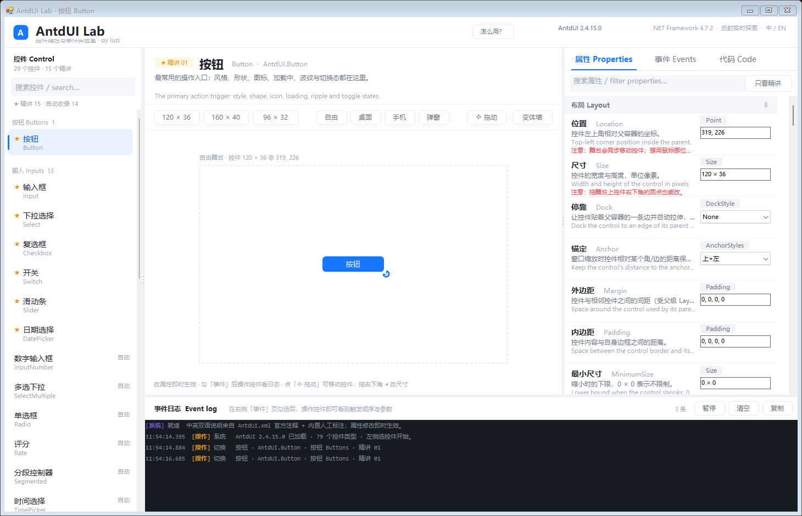
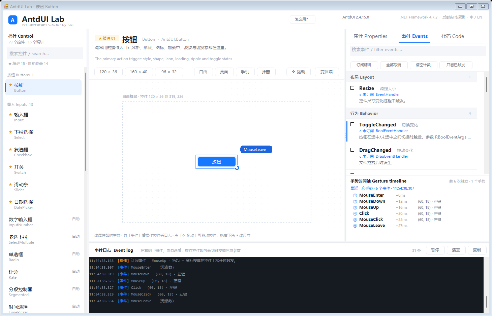
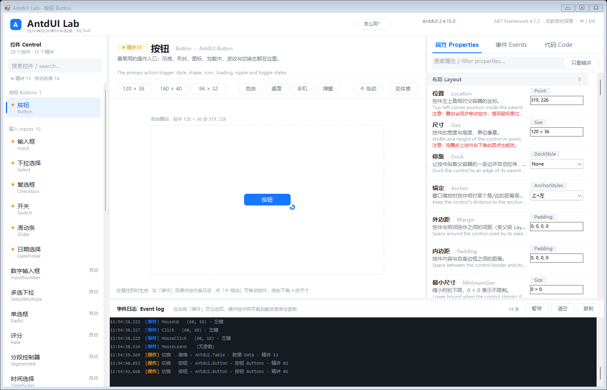
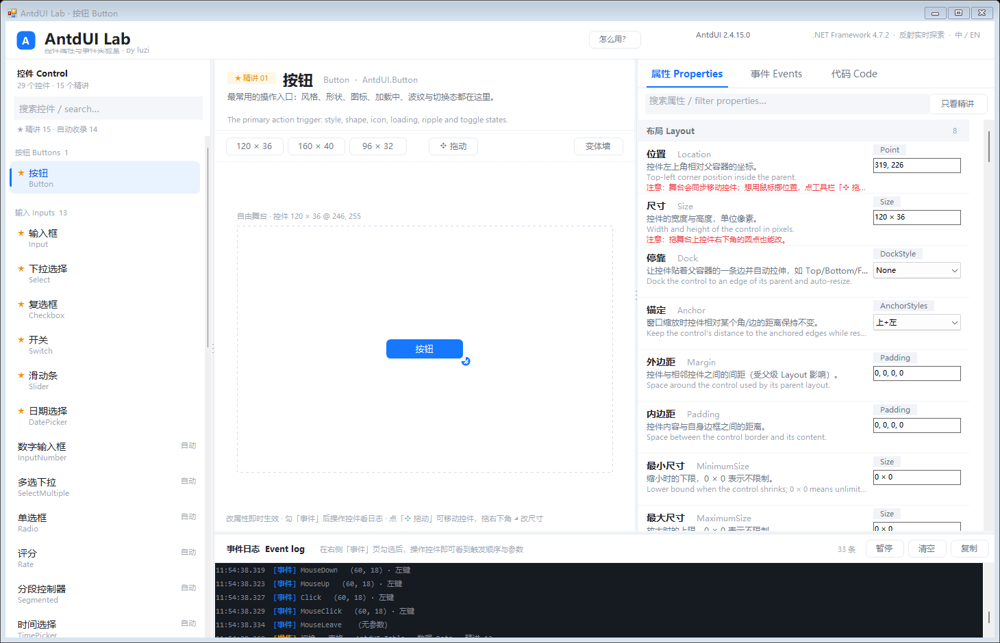
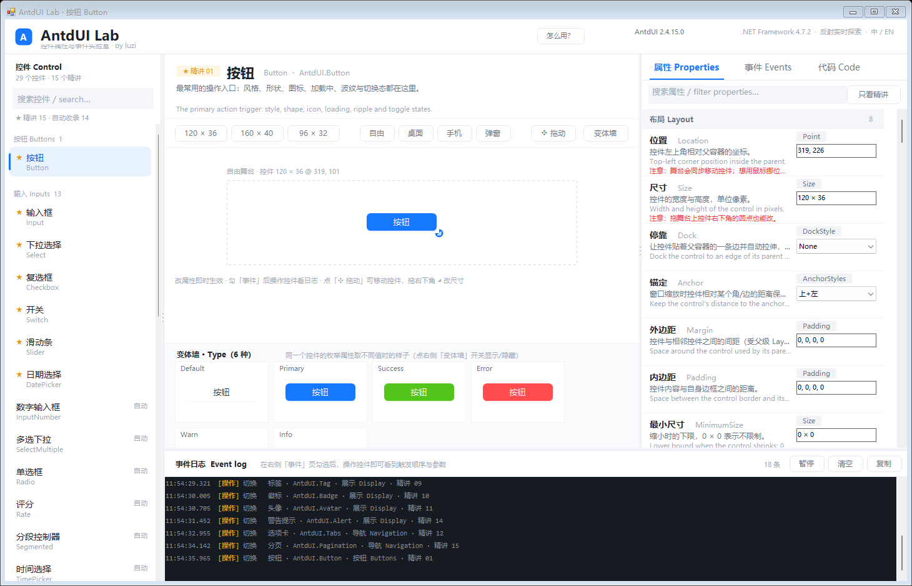
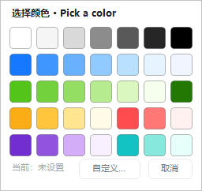

# AntdUI Lab · 控件属性与事件实验室

> 一个把 AntdUI 的「属性 + 事件」摊开给你看的 WinForms 小工具：左边选控件、中间看真实渲染、右边逐条读中英说明，勾上事件点一点，触发顺序和参数立刻出来。
>
> *An interactive explorer for AntdUI controls on WinForms — browse properties with bilingual docs, subscribe events and watch them fire in order, then copy the generated C#.*

**29 个控件**里有 **15 个精讲**（人工写好的中英说明 + 常见坑），其余自动收录；属性改一个值舞台立刻变，事件勾一下就能看到触发顺序、间隔毫秒和参数。

| 主界面 | 事件仪表盘 |
| --- | --- |
|  |  |

| 「布局」分组（和 VS 一样） | 拖动分隔条调栏宽 |
| --- | --- |
|  |  |

| 变体墙 | 取色板 |
| --- | --- |
|  |  |

- 目标框架：`.NET Framework 4.7.2`（VS2019 / VS2022 都能直接打开 `AntdUILab.sln`，不用装额外工作负载）
- 控件库：`AntdUI 2.4.15`（`lib\AntdUI.dll`，运行时反射加载，**不需要在项目里引用 AntdUI**）
- 界面语言：中文在前、英文并列，数据来自 `AntdUI.xml` 官方注释 + 人工补充层
- 作者 / 发布者：**luzi**（exe 的「公司 / 版权 / 商标」版本信息均已设为 luzi）
- 仓库里的代码随便用；`AntdUI.dll` 的版权归 AntdUI 作者，遵循其自身许可证，本仓库不打包它

---

## 一、怎么启动

**环境**：Windows + .NET Framework 4.7.2（Win10/11 自带），无需联网、无需装 .NET SDK。

1. 把 **AntdUI 2.4.15** 的两个文件放进 `lib\`：
   - 从 NuGet 下载 <https://www.nuget.org/packages/AntdUI/2.4.15>（`.nupkg` 改成 `.zip` 解压），
     取 `lib\net46\AntdUI.dll` 和 `lib\net46\AntdUI.xml`，复制到本仓库的 `lib\` 目录；
   - 或者直接从你自己工程的 `packages\AntdUI.2.4.15\lib\net46\` 里拷过来。
   - 仓库默认不提交这两个二进制文件，请按 AntdUI 的许可证自行获取。
2. 双击 `run.cmd`（会自动用 VS 的 MSBuild 构建再启动），或直接运行 `bin\Debug\AntdUILab.exe`。
3. 首次打开会自动选中「★ 精讲 01 按钮」，右上角有 **「怎么用？」** 帮助窗口。

> 只读加载 `AntdUI.dll` / `AntdUI.xml`，不会修改任何工程文件。
> 如果提示找不到 AntdUI，请确认 `AntdUI.dll` 与 `AntdUI.xml` 和 exe 在同一个目录（构建时会自动复制）。

---

## 二、界面四个区域

```
┌────────────┬──────────────────────────────────────────┬──────────────┐
│  控件导航   │   预览舞台（真实控件 + 尺寸 / 场景 / 变体墙）  │ 属性/事件/代码 │
│  29 个控件  │                                          │  检查器 424px │
├────────────┴──────────────────────────────────────────┴──────────────┤
│                        事件日志（触发顺序 + 参数）                      │
└──────────────────────────────────────────────────────────────────────┘
```

1. **左侧导航**：`★ 精讲 15` + 其余 14 个自动收录（共 29 个控件），按分组（按钮 / 输入 / 数据 / 展示 / 导航）排列，顶部可搜索。
2. **中间舞台**：真实实例居中显示；顶部是尺寸预设（`120×36` 等）、场景（自由 / 桌面 / 手机 / 弹窗）和「变体墙」开关。
3. **右侧检查器**：`属性 Properties`、`事件 Events`、`代码 Code` 三个页签。
4. **底部事件日志**：系统消息、属性修改、事件触发都按时间顺序记录，带类别颜色。

---

## 三、三条学习路径

### 1）属性：它有哪些、各自干什么

属性按 **和 VS 属性窗口一样的分类** 分组显示：`布局 Layout`、`设计 Design`、`外观 Appearance`、`边框 Border`、`阴影 Shadow`、`徽标 Badge`、`行为 Behavior`、`数据 Data`、`操作 Action`… 每组标题右边是该组的成员数。**布局排在最上面**，组内成员也按 VS 的顺序：位置 → 尺寸 → 停靠 → 锚定 → 外边距 → 内边距 → 最小 / 最大尺寸。

其中 **`布局 Layout`** 就是 VS 里那一组：`位置 Location`、`尺寸 Size`、`停靠 Dock`、`锚定 Anchor`、`外边距 Margin`、`内边距 Padding`、`最小/最大尺寸`。
改 `位置 / 尺寸` 舞台会同步移动或缩放控件；反过来在舞台上拖控件、拖右下角圆点改尺寸，右侧这两行也会实时刷新。

每行从左到右是：

| 位置 | 内容 |
| --- | --- |
| 中文名 + English | 例如 `风格 Type`、`波浪半径 WaveSize` |
| 中文作用 | 一句话说明这个属性控制什么 |
| 英文说明 | 对应的英文解释（和中文一一对应） |
| `注意：…` | 只有踩过坑的属性才有，红字提示 |
| 右上角类型 chip | `TTypeMini` / `bool` / `int` / `Color?`…；标 **需代码** 的是集合或复杂类型 |
| 左侧 3px 蓝条 | **精讲属性**：有人工整理的中英说明；没有蓝条的是反射自动收录的原生属性 |

- 直接改右侧输入框 → **立即生效**，并写进底部日志（例如 `属性 Type → TTypeMini.Success`）
- 布尔值用「开 / 关」勾选框、枚举用下拉、颜色点开色板、数值/字符串直接输入（字符串改一个字符就生效）
- 复合值直接敲进去就行，**回车、点别处、或者停手半秒**都会提交：位置 `x, y`、尺寸 `宽 × 高`（也认 `180x44`）、外边距/内边距 `左, 上, 右, 下`；输错了（比如只打了个 `1`）不会动控件，补全后自动生效
- 改「位置 / 尺寸」时舞台立刻跟着动；反过来在舞台上拖动控件、拉右下角圆点，右侧这两个框也会跟着刷新
- 搜索框可按中文名 / 英文名 / 说明过滤；**「只看精讲」** 按钮只保留带人工说明的属性
- 鼠标悬停整行，可看到**完整**中英文说明、注意点、当前值和类型

> **中文说明是怎么来的（三层兜底）**
> 1. 人工中英说明（`App/Docs.cs` + `App/Catalog.cs`）：精讲属性都在这层，含作用、英文、常见坑；
> 2. AntdUI 官方 XML 注释（`AntdUI.xml`）：注意很多属性注释是写在**接口**上的（如 `IControl.Badge`），
>    程序会同时沿基类和实现的接口链去找；
> 3. 都没有时：用内置词表把英文名直译成中文名（`BadgeBorderWidth → 徽标边框宽`），说明行显示
>    `官方无注释 · 改值后看舞台效果`——这类属性官方文档本身就没写，程序不编造含义，让你直接改值看效果。
>
> 当前 29 个控件里，可见属性/事件的中文名覆盖率是 100%；约 96% 的属性有官方中文作用说明，
> 剩下 4%（如 `HandDragFolder`、`ExtraMouseHover`）官方没写注释，保留占位提示。

### 2）事件：有哪些、什么时候触发、触发了多少次

事件页不只是清单，它本身就是一块**实时仪表盘**：

- 事件按 `操作 / 行为 / 鼠标 / 键 / 布局…` 分组（和 VS 事件窗口一致），每行给出：
  `Click 点击` / `● 已订阅 · EventHandler` / 触发时机的中英说明 / 注意点
- **勾选即订阅**。勾完去中间点一点、拖一拖、改一改，右侧那一行会立刻变化：
  - 整行闪一下蓝，右上角出现 `×3`（触发次数）和 `0.2s 前`（最近一次多久以前）
  - 行里多出一行 `最近：(60, 18) · 左键`——参数被翻译成人话，而不是 `MouseEventArgs`
  - 没触发过的行显示 `待触发`，一眼看出「这个事件到底什么时候才会来」
- **工具条**：`订阅精讲`（只订阅 ★ 标注的几个常用事件）、`全部取消`、`清空计数`、`只看已触发`（把没触发过的事件先藏起来）
- **手势时间轴**（事件页下半部）：同一次操作里的连续事件会被归成**一个手势**，带 `①②③` 序号和 `+Δms`：

  ```
  最近一次手势 · 6 个事件 · 11:15:51.446
  ① MouseEnter   +0ms
  ② MouseDown   +12ms   (60, 18) · 左键
  ③ MouseUp     +15ms   (60, 18) · 左键
  ④ Click       +18ms   (60, 18) · 左键
  ⑤ MouseClick  +21ms   (60, 18) · 左键
  ⑥ MouseLeave  +25ms
  ```

  这样你就能看到「一次点击到底按什么顺序触发了哪些事件、每个事件隔了多少毫秒」。
- **舞台脉冲**：事件触发时，舞台上的控件外圈会脉冲一圈蓝光，旁边浮出一个标签写着「哪个事件 + 什么参数」，
  不用在右侧和舞台之间来回找。
- 底部日志仍然是完整流水账（含全部事件与属性修改），想回看顺序就翻日志。

看到参数后，回到「代码」页就能拿到对应的 `+= (s, e) => { … }` 写法。

### 3）代码：直接抄到自己的 Form

- 代码页始终显示**当前控件 + 当前改过的属性 + 已勾选事件**的初始化代码
- 只输出「和默认值不同」的属性，所以代码很短、很好读
- 右上角「复制代码」一键进剪贴板

```csharp
// AntdUI 2.4.15 · .NET Framework 4.7.2 · 由 AntdUI Lab 生成
// 需 using System.Drawing; using System.Windows.Forms;
var button = new AntdUI.Button();
button.Size = new Size(120, 36);
button.Text = "按钮";
button.Type = AntdUI.TTypeMini.Primary;
Controls.Add(button);
```

---

## 四、舞台上的小工具

- **尺寸预设**：切换控件大小，观察控件在不同尺寸下的排布（很多 AntdUI 控件高度为 0 时根本不画，这里给了合理默认值）
- **场景**：`自由` 是虚线自由舞台；`桌面 / 手机 / 弹窗` 是带圆角阴影的取景框，方便看控件放进多大容器里合适
- **变体墙**：把某个枚举属性（如 `Type`、`Shape`、`Status`）的**所有取值并排渲染**，一眼看清区别
- **✥ 拖动**：点一下进入拖动模式（控件暂时不响应点击），按住控件就能在舞台上挪位置；再点一下退出。拖动中虚线框变蓝
- **◢ 缩放手柄**：控件右下角的蓝色圆点，按住拖动即可改尺寸，左上角标注会实时显示 `控件 宽 × 高 @ x, y`
- **取色**：颜色属性点开是 35 色常用色板（灰阶 / 主色蓝 / 成功绿 / 警告错误 / 紫青），右下「自定义…」打开系统取色器，点「取消」或 Esc 退出
- **滚轮**：鼠标停在左侧导航、右侧属性 / 事件列表上（或代码页里）直接滚轮就滚，不用先点一下抢焦点
- **分隔条**：导航右边、检查器左边、日志上边各有一条 6px 的灰色分隔条，按住左右 / 上下拖动就能改导航宽度、检查器宽度、日志高度（鼠标移上去会变蓝并出现三个小点）。窗口窄的时候工具栏会自动把「场景」按钮收起来，避免挤成一团

---

## 五、精讲清单

| # | 控件 | 一句话 |
| --- | --- | --- |
| 01 | Button 按钮 | 风格、形状、图标、加载中、波纹与切换态 |
| 02 | Input 输入框 | 状态、变体、前后缀、清除按钮、校验回调 |
| 03 | Select 下拉选择 | 选项集合、选中项、下拉方向、过滤 |
| 04 | Checkbox 复选框 | 勾选、半选、自动勾选、文字对齐 |
| 05 | Switch 开关 | 开关文案、加载中、填充色 |
| 06 | Slider 滑动条 | 范围、步进、刻度标记、数值格式 |
| 07 | DatePicker 日期选择 | 格式、面板类型、预设、回填今天 |
| 08 | Table 表格 | 列定义、DataTable 数据源、固定表头、编辑 |
| 09 | Progress 进度条 | 形状、状态、百分比文本、步骤条 |
| 10 | Tag 标签 | 类型、可关闭、圆角、图标 |
| 11 | Badge 徽标 | 状态色、文本、圆点比例 |
| 12 | Avatar 头像 | 文字/图片、圆形方形、阴影、悬停 |
| 13 | Alert 警告提示 | 标题、图标、可关闭、滚动播放 |
| 14 | Tabs 选项卡 | 页集合、选中页、线条/卡片样式、溢出 |
| 15 | Pagination 分页 | 总数、每页数量、当前页、尺寸切换 |

其余 14 个（InputNumber、SelectMultiple、Radio、Rate、Segmented、TimePicker、ColorPicker、Label、Divider、Battery、Spin、Breadcrumb、Steps、Timeline）作为「自动收录」，属性说明来自 AntdUI 官方 XML 注释。

---

## 六、目录结构

```
AntdUILab\
├─ AntdUILab.sln
├─ run.cmd                      ← 双击启动
├─ README.md                    ← 就是本文
├─ .gitignore                   ← 忽略 bin\obj\ 与第三方 DLL
├─ _shots\                      ← 27 张界面截图（README 配图 + 自检，可删）
├─ lib\AntdUI.dll / AntdUI.xml  ← 被复制的控件库与文档
└─ AntdUILab\
   ├─ Program.cs                ← 入口（--shot 进入截图自检模式）
   ├─ MainForm.cs               ← 顶栏 + 四区布局
   ├─ App\
   │  ├─ Loader.cs              ← 按字节加载 AntdUI，建立类型索引
   │  ├─ XmlDocs.cs             ← 解析 AntdUI.xml 的中文 summary
   │  ├─ Reflect.cs             ← 反射读写属性 / 给任意签名事件挂委托
   │  ├─ Docs.cs                ← 人工双语说明层（中文名/作用/坑）
   │  ├─ Catalog.cs             ← 控件清单：分组、初始配置、默认尺寸
   │  ├─ EventHub.cs            ← 事件订阅与日志
   │  ├─ CodeGen.cs             ← 生成可粘贴的 C# 代码
   │  └─ Theme.cs               ← 配色 / 字体 / 绘图小工具
   └─ Ui\                       ← 导航、舞台、检查器、日志、变体墙、帮助窗
```

### 想加一个控件？

1. 在 `App\Catalog.cs` 里加一条 `Star(...)` 或 `Auto(...)`：类型名、中英文名、分组、介绍、默认尺寸、`Init` 里写初始配置；
2. 在 `App\Catalog.cs` 的 `Overrides()` 里补中英属性/事件说明（不补也能跑，会自动回退到 XML 注释）；
3. 重新生成即可，左侧列表、属性页、事件页、代码页全部自动生效。

---

## 七、实现要点（为什么这样写）

- **不使用设计器**：所有控件在代码里创建，方便按「类型 + 配置」批量生成；
- **反射加载 AntdUI**：在部分被策略锁定的机器上 `Assembly.LoadFrom` 会抛 `0x80131515`，所以改用 `Assembly.Load(File.ReadAllBytes(...))`；好处是工程不需要引用 AntdUI，也不受版本绑定影响；
- **属性/事件说明三层**：反射拿「存在性 / 类型 / 默认值」→ `AntdUI.xml` 拿官方中文注释 → `Docs.cs` 人工层补中英文名、作用、坑；
- **任意签名的事件订阅**：用表达式树把 `Action<string, object, object[]>` 包成 `EventHandler` / `AntdUI.TypingEventHandler` 等具体委托，所以 30 多个事件都能一键勾选；
- **代码生成**：与默认实例逐属性比较，只输出改动过的简单属性，枚举输出成 `AntdUI.TTypeMini.Primary` 这样的全名。

---

## 八、已知限制

- 集合类属性（`Table.Columns`、`Tabs.Pages`、`Select.Items` 等）标记为「需代码」，在 UI 里只能看数量，不能在表格里逐项编辑；
- 暗色主题（`Config.Mode = Dark`）在部分标准控件和表格行上对比度不足，v1 只做浅色；
- 截图自检模式 `AntdUILab.exe --shot <目录>` 会批量输出 27 张图（README 里的配图就是这么来的），仅供开发自检使用。
